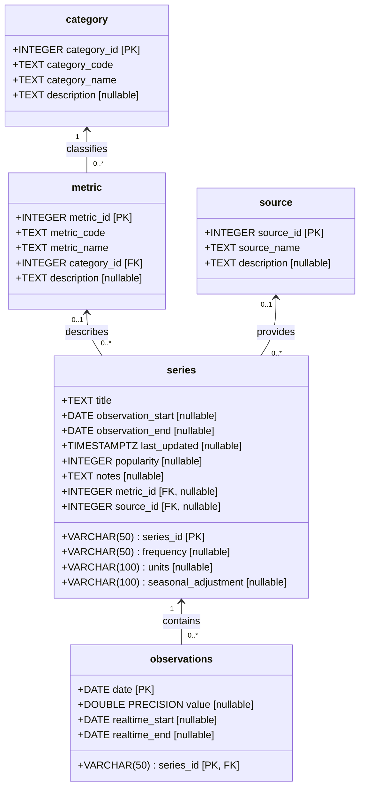
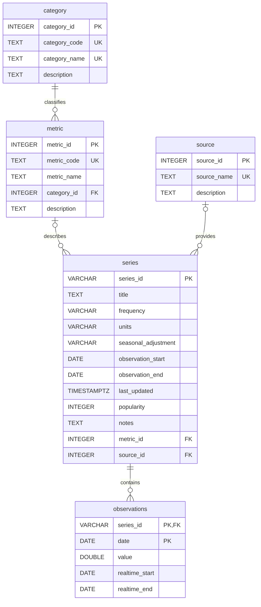

# CS457 Project Design — FRED Research Database

**Status:** Final Design 
**Database:** PostgreSQL (`fred_db`)  
**Primary data provider:** Federal Reserve Economic Data (FRED)

## 1. Overall Software System Goal

The goal of this project is to build a flexible, reusable research database system for collecting and organizing economic time-series data for statistical analysis. The initial research will focus on relationships between U.S. electricity prices, utility capacity, capacity utilization, and electric-power infrastructure investment. Understanding these relationships may provide insights into electricity market dynamics and potentially support investment and market-positioning decisions.

One of the primary design goals is flexibility and extensibility. As the research progresses, additional economic and energy-related datasets may be needed to expand the analysis, investigate new relationships, or answer questions not anticipated during the initial design. Rather than constructing a database around a fixed set of variables, the system uses a generalized relational schema capable of accommodating multiple categories, metrics, data sources, and time series.

The database separates research classifications (category and metric), data providers (source), time-series metadata (series), and numerical measurements (observations) into five related tables. This design allows new datasets to be incorporated by adding records to existing tables rather than modifying the underlying schema. For example, future research might examine natural gas prices, electricity demand, or employment trends alongside electricity prices and generating capacity.  These would be added incrementally with minimal cost. 

The planned analysis workflow uses SQL queries and time-aligned PostgreSQL views, accessed directly by R using DBI and RPostgres (SW packages available in R that allow R to directly communicate with PostgreSQL). PostgreSQL remains the source of truth, eliminating the need for routine CSV exports.
 

**High-level workflow flow:**

```text
FRED API → Python ingestion/mapping → PostgreSQL (fred_db)
                                          ↓
                               SQL queries and research views
                                          ↓
                                    R statistical analysis
```

**Data Ingestion**

A Python application retrieves series metadata and dated observations from the FRED API, performs basic data cleaning and validation, and stores the results in PostgreSQL. The ingestion process uses configurable mappings to associate incoming FRED series with the appropriate research categories and metrics. This supports incremental expansion of the research dataset without requiring modifications to the underlying database structure.

The current database design supports dated, numeric time-series observations. Accommodating fundamentally different data structures may require additional tables or schema modifications.

## 2. UML Class Diagram (Database Design)

The diagram below models the five database tables as UML classes. Attributes show PostgreSQL types and key designations. Relationship multiplicities reflect both the foreign keys and their nullability.

**Key legend:**

- **PK** — Primary key; uniquely identifies a row.
- **AK (supplemental key)** — Alternate candidate key, enforced by a `UNIQUE NOT NULL` constraint.
- **FK** — Foreign key; references a primary key in another table.
- **PK, FK** — Attribute participates in the primary key and is also a foreign key.
- **nullable** — Attribute may contain SQL `NULL`.




### 2.1 Relational Schema and Keys

| Relation       | Primary key           | Candidate keys | Foreign keys                                                   |
| -------------- | --------------------- | --------------------------------------- | -------------------------------------------------------------- |
| `category`     | `category_id`         | `category_code`, `category_name`        | —                                                              |
| `metric`       | `metric_id`           | `metric_code`                           | `category_id → category.category_id`                           |
| `source`       | `source_id`           | `source_name`                           | —                                                              |
| `series`       | `series_id`           | —                                       | `metric_id → metric.metric_id`; `source_id → source.source_id` |
| `observations` | (`series_id`, `date`) | —                                       | `series_id → series.series_id` (`ON DELETE CASCADE`)           |


## 3. Entity–Relationship Model (ERM)

Notes on Symbols:   The `||` end means exactly one; `o{` means zero or many; `o|` means zero or one. The drawing focuses on keys and representative attributes; the UML diagram above lists every column.




### 3.1 Table Responsibilities

| Table          | Purpose                                                                                               | Example                                            |
| -------------- | ----------------------------------------------------------------------------------------------------- | -------------------------------------------------- |
| `category`     | Locally defined broad research categories (the things to analyze)                                                         | Price, Capacity, Investment                        |
| `metric`       | Specific quantaties to measure within a category                                                | Electricity Price, Utility Capacity                |
| `source`       | Identifies where a series originates                                                                  | FRED                                               |
| `series`       | Stores an external series identifier and metadata from source (e.g. FRED), together with Foreign-key references connecting external datasets to internally defined research metrics and data sources. | `APU000072610` - FRED series identifier                                    |
| `observations` | Stores one dated numerical value per series/date.            | Electricity-price observation on a particular date |

The `category`, `metric`, and `source` records form a locally maintained classification/provider layer. The `series` and `observations` tables store information retrieved from FRED. 

Adding a new numeric time series requires updating the research mapping configuration and inserting records into the existing database tables.  We don not modifying the schema. The mapping configuration associates an external series identifier with the appropriate research category and metric. During ingestion, the application uses these mappings to establish the necessary foreign-key relationships, stores the series metadata, and inserts its dated numerical observations into `observations`. Existing categories, metrics, and data sources can be reused, with new classification records created **only when necessary**. This approach allows the research dataset to expand incrementally while preserving the existing table structure, relationships, and previously collected data. For example: 

Suppose we discover an interesting natural gas price series in FRED. To incorporate it, we would:

1. Update config/series_mapping.json in the ingestion pipeline — Associate the FRED series ID with our existing Price category and a new Natural Gas Price metric.
2. Update `metric` — Insert a new Natural Gas Price metric, referencing the existing Price category.
3. Update `series` — Insert the FRED series identifier, metadata, and foreign-key references to the metric and source.
4. Update `observations` — Insert the dated numerical measurements retrieved from FRED.

## 4. Third Normal Form (3NF) Justification

**3NF.** For every nontrivial functional dependency `X → A`, either `X` is a superkey or `A` is a prime attribute (part of some candidate key). Under the intended data semantics, the principal dependencies are:

```text
category_id       → category_code, category_name, description
category_code     → category_id, category_name, description
category_name     → category_id, category_code, description

metric_id         → metric_code, metric_name, category_id, description
metric_code       → metric_id, metric_name, category_id, description

source_id         → source_name, description
source_name       → source_id, description

series_id         → title, frequency, units, seasonal_adjustment,
                    observation_start, observation_end, last_updated,
                    popularity, notes, metric_id, source_id

(series_id, date) → value, realtime_start, realtime_end
```

## 5. Design Summary

The database has five relations and four declared foreign-key relationships. Three locally maintained tables organize the research vocabulary and data sources; two tables hold FRED series metadata and observations. The design is normalized to 3NF under the stated dependencies, supports expansion to additional numeric FRED time series without new tables, and provides a relational foundation for PostgreSQL queries and statistical analysis in R.


